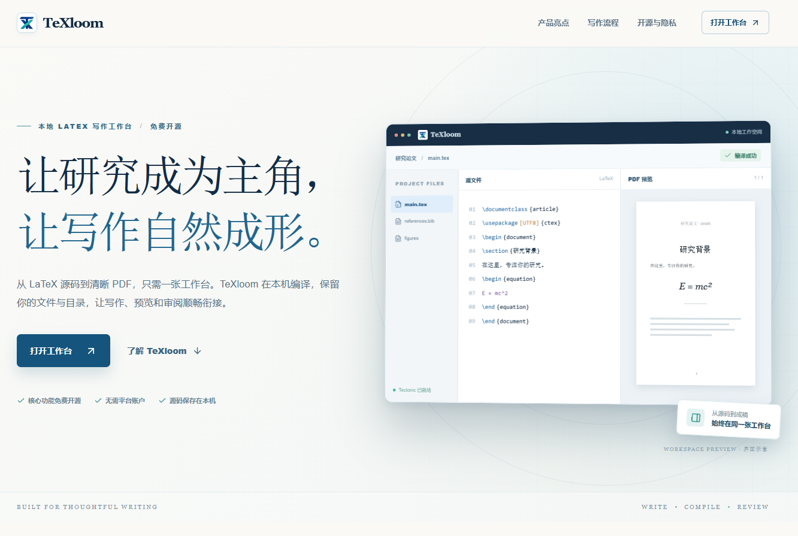
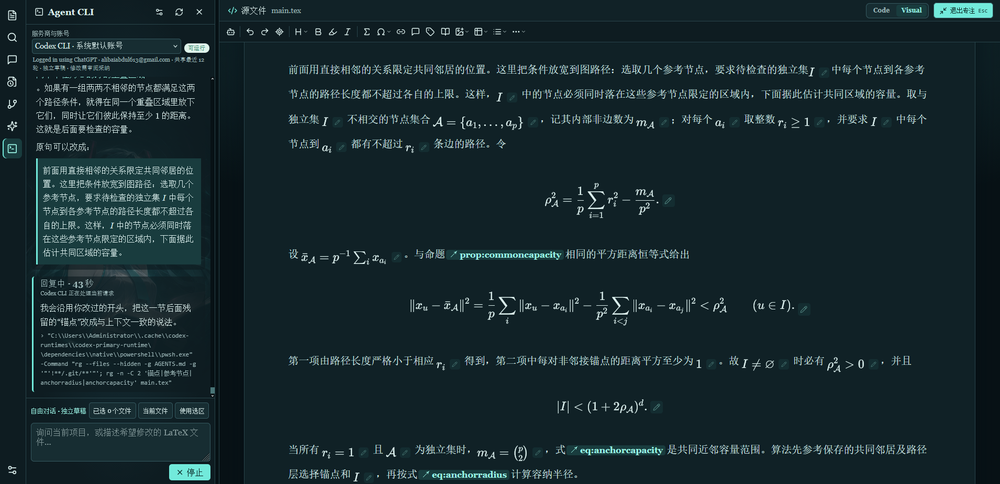

<div align="center">
  
  <h1>TeXloom</h1>
  <p>Write in Visual, edit the LaTeX source in Code, and compile PDFs with Tectonic on your computer.</p>
  <p><strong>Visual writing · Local builds · Multi-provider AI</strong></p>
</div>

[简体中文 README](README.md) · [Product tour](https://stuboo3i.github.io/TeXloom/?lang=en) · [Visual editor](https://stuboo3i.github.io/TeXloom/?lang=en#visual) · [Multi-provider AI](https://stuboo3i.github.io/TeXloom/?lang=en#ai)



## What you can do

- **Write in Visual or Code.** Edit a paper's text, headings, proofs, equations, and figure captions in place. Switch to Monaco for full control of the same LaTeX source.
- **Compile and navigate.** Tectonic runs locally. Keep the PDF beside your editor, use SyncTeX to jump in both directions, and preview individual figures and tables on demand.
- **Review with your team.** Work on separate GitHub branches, inspect remote files, and sync comments and suggestions. Merge through a pull request after review.
- **Work with several AI providers.** Switch Agent CLI accounts and providers within a project, or use the separate AI API tools for a quick translation, rewrite, or package suggestion.
- **Manage projects locally.** Import ZIPs, clone GitHub repositories, move projects in bulk through folders, and organize the work with categories and tags.

## Install on Windows

### Requirements

- Windows 10 or 11 with a desktop session for the native folder picker.
- Node.js 20.19+ or 22.12+ (Node.js 24 recommended), npm, and Git if you clone the repository.
- `runtime/tectonic.exe`. If the executable is absent, get the Windows build from the [Tectonic releases](https://github.com/tectonic-typesetting/tectonic/releases) and place it there.
- Agent CLI tools are optional. Install the provider's CLI and sign in or configure credentials if you plan to use it.

### First run

```powershell
git clone https://github.com/StuBoo3i/TeXloom.git
cd TeXloom
npm ci --include=dev
npm run build
npm run start
```

Open [the local product page](http://127.0.0.1:3001/) or go directly to [the workspace](http://127.0.0.1:3001/?view=workspace&lang=en). The service listens on `127.0.0.1:3001` by default. Keep the terminal open and press `Ctrl+C` to stop it. On the first build of a LaTeX document, Tectonic may download support files and cache them locally.

For daily use, run `npm run start` or double-click `start.cmd`. You can also run `.\start.ps1`. The startup scripts install missing dependencies and build the frontend if there is no existing build.

### Update an existing installation

Stop the running service, then run the following in the TeXloom folder.

```powershell
git pull --ff-only
npm ci --include=dev
npm run build
npm run start
```

For a ZIP-based installation, update the source files and run the three npm commands. Keep `projects/`, `data/`, and any custom project folders. Rebuild after updating the source because the startup script reuses an existing build.

### Develop locally

```powershell
npm ci --include=dev
npm run dev
```

The Vite frontend runs at [port 5173](http://127.0.0.1:5173/) and proxies API calls to the Fastify service on port 3001. `npm run build:pages` builds the static product tour to `dist-pages/`.

## Language and appearance

Open a project and select **Settings → Appearance → Interface language** to switch between English and simplified Chinese. The product tour and project list also have a language button. The preference is saved in your browser. Use `?lang=en` to open the English version from a link.

Appearance settings let you choose the interface font, size, and theme. LaTeX continues to control your document language, page layout, and PDF fonts.

## Write, compile, and find your place

1. Open a `.tex` project and switch between **Code** and **Visual** in the editor header. Both modes use the same source, undo history, and save workflow.
2. Edit text and headings directly. Click a formula to edit it. The toolbar inserts styling, headings, lists, symbols, references, figures, and tables at the active position.
3. Choose **Compile PDF** for the full document. Use the split, editor-only, or PDF-only layout, or open the PDF in a separate tab. Drag the divider to resize the panes or double-click it to reset their widths.

### Navigation and completion

- In **Visual**, **Ctrl+click** a reference to jump to its definition. Citations open the corresponding `.bib` or `\bibitem` source. Use **⌘+click** on macOS. A regular click edits the reference key.
- After compilation, use the source-to-PDF toolbar button, or press `Ctrl+Alt+J` in Code. Double-click the PDF to go back to the source. Recompile older PDFs that have no SyncTeX data.
- LaTeX completion covers commands, environments, math symbols, packages, local macros, paths, labels, and citation keys. In Visual, use `Ctrl+Space` in an editable field to open suggestions, select one with the arrow keys, and confirm with Enter or Tab.
- Use **Help → Keyboard shortcuts** for commands and mouse gestures. Press Esc to leave focus mode.

### Figures, tables, and references

- Visual cards render captions and formulas and can show a preview, open the source, or compile in isolation. The compiled card preview crops page margins and offers the full PDF separately.
- For **Compile draft**, select which cards to include. Supported, unchecked figures and tables become placeholders in the temporary draft build. A full build uses the complete source.
- Reference pickers index labels in project `.tex` files and bibliography keys from `.bib` and `thebibliography`. Filter by figure, table, equation, chapter, or citation. Refresh the list after external changes.
- Images can come from your computer, this project, another project, or a public HTTPS URL. The insert tools can add required package declarations to the main file.

## Project organization and collaboration

Choose a project root on first use or keep the default `projects/` root. **Local workspace** shows its location and allows a change for new projects. Existing projects remain accessible at their original paths. Custom roots live outside the TeXloom source directory.

Use personal, shared, archived, and custom tag filters. A shared label is local categorization. GitHub controls repository access. To migrate projects, bulk import from a local folder or export selected projects to separate folders. Export metadata preserves the main file, category, and tags for reimport.

### Private GitHub repositories

1. Invite collaborators in GitHub and let each one connect using their own account. Use an HTTPS URL with Git Credential Manager or an SSH URL. Keep credentials out of the URL.
2. Fetch and browse remote branches, compare changes, and work on a personal branch such as `feature/name/topic`.
3. Push the branch and open a pull request on GitHub. TeXloom blocks direct pushes to `main` and `master` from its interface, and pulls are fast-forward only.

Comments, replies, and suggestions sync as JSON events on a separate `texloom-reviews` branch. TeXloom verifies the original passage before applying a suggestion. The local review name is a display name. GitHub pull-request review provides the authenticated approval. Use **History** to create, restore, or remove snapshots.

## Multi-provider AI

### Agent CLI

Open **Agent CLI** in the sidebar for project-level tasks. The conversation is stored locally and each provider account keeps its own native session. Choose whether to share recent project conversation across accounts or providers. Attach files or the editor selection when they help the request. The agent can inspect the project draft on its own.

| Agent | Account and model options |
| --- | --- |
| Codex CLI | System sign-in or a separate local profile. Set the model and reasoning effort. |
| Gemini CLI | System sign-in or a separate local profile. Set the model. |
| Claude Code | Separate API key and local configuration. Set the model and supported reasoning effort. |
| Doubao CLI | System sign-in. The CLI manages its model settings. |



Agents work in a local draft copy under `data/agent-workspaces/`. When a run changes files, open **Review and apply changes** and accept the files or text hunks you want. For conflicting edits, inspect the baseline, current file, and agent draft, then choose the version to keep. Applying changes creates a snapshot and syncs the editor with the project. You can stop an active run at any time. Provider-specific output and diagnostic messages come from the installed tools.

### AI API

Open **Settings → AI API** to configure DeepSeek, Volcano Engine Ark, Alibaba Cloud Model Studio, OpenAI, or Claude. Each provider has its own API key and model settings. Use the writing panel to translate, polish, explain a build error, rewrite, or generate a formula or table. Preview the proposed edit before applying it.

The **Package suggestions** panel can analyze the project locally without a key. AI analysis uses the configured provider when requested. Review the proposed `\usepackage` change, then compile to verify compatibility.

### Local data and credentials

- Editing and local compilation require no AI key or cloud account. Git and AI calls occur when you use those tools. Providers apply their own service terms and usage charges.
- API keys are encrypted on Windows for the current user with DPAPI and kept under `data/`. A request sends the selected content and prompt to the active provider.
- TeXloom's draft workspace separates the review and apply workflow from the original project. The external CLI runs with the permissions of your Windows account. Keep project context and account access appropriate for the provider you choose.
- Default `projects/` and `data/` are ignored by Git. Keep private project files and credentials outside the source repository.

## Source layout and verification

| Path | Purpose |
| --- | --- |
| `client/` | React workspace, product tour, Monaco, and PDF.js |
| `server/` | Fastify project, compiler, Git, and local configuration APIs |
| `runtime/tectonic.exe` | Windows LaTeX engine |
| `tests/` | Unit and smoke tests |

```powershell
npm run build
npm run build:pages
npx tsx --test tests/editor-features.test.ts tests/synctex.test.ts tests/git-collab.test.ts tests/review-events.test.ts tests/latex-completion.test.ts tests/reference-index.test.ts tests/package-advice.test.ts tests/visual-latex.test.ts
```

If compilation is slow, let Tectonic finish its initial cache, then consider turning off auto-compile for large documents or heavy TikZ projects. If CJK text is missing in the PDF, specify a font available to Tectonic in the LaTeX source.

TeXloom is distributed under the [MIT License](LICENSE). Third-party notices and licenses are listed in [THIRD_PARTY_NOTICES.md](THIRD_PARTY_NOTICES.md).
