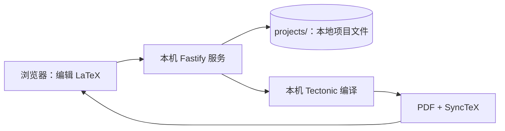
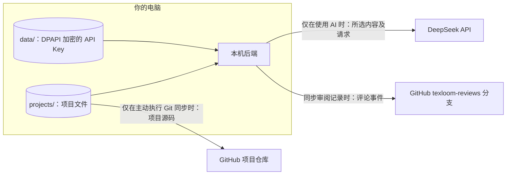

<div align="center">
  
  <h1>TeXloom</h1>
  <p>在浏览器中组织 LaTeX 项目、专注写作，并用本地 Tectonic 引擎生成 PDF。</p>
  <p><strong>本地工作空间 · 即时预览 · GitHub 私有仓库协作</strong></p>
</div>


> TeXloom 面向 Windows 单用户桌面环境。项目文件保存在本机；只有你主动使用 Git 协作时，所选项目的源码才会同步到对应远程仓库。

## 功能一览

| 写作与预览 | 项目管理 | 协作与扩展 |
| --- | --- | --- |
| Monaco 编辑器、LaTeX 工具栏、PDF 预览与 SyncTeX 双向定位 | 项目分类与标签、批量导入导出、文件树、全文搜索、历史快照 | GitHub 私有仓库分支协作、评论与修改建议、可选 DeepSeek 助手 |

### 从源码到 PDF



## API Key 管理与多人协作安全

- **项目留在本机。** 项目文件放在 `projects/`，应用不会自动上传项目；该目录及本机设置目录 `data/` 均被仓库的 `.gitignore` 排除。只有你主动连接远程仓库并执行 Git 同步时，相应项目源码才会传到该远程仓库。
- **密钥由本机管理。** DeepSeek API Key 由 Windows 当前用户的 DPAPI 加密后保存在 `data/ai-settings.json`。设置接口只返回是否已配置，不回传明文；可在设置中清除 Key、调整模型、输出上限和超时。调用 AI 时，后端才解密 Key，并将你提交的提示词、选中文本、额外上下文或图片发送至 DeepSeek。普通编辑和编译无需 Key。
- **协作使用个人分支。** Git 远程地址只接受不含凭据的 GitHub HTTPS 或 SSH 地址；请使用 Git Credential Manager 或 SSH 登录，不要把令牌放进 URL。应用内拒绝直接推送 `main` / `master`，拉取仅允许快进，并在拉取前检查本地未提交改动。评论与修改建议可同步到独立的 `texloom-reviews` 分支；接受建议前会校验原文。

### 数据何时离开本机



这些限制只约束 TeXloom 内的操作。正式代码审阅和主分支保护请在 GitHub 仓库中配置；不要把仓库访问权限授予不可信人员。

## 快速开始

```powershell
git clone https://github.com/StuBoo3i/TeXloom.git
cd TeXloom
.\start.ps1
```

也可以在资源管理器中双击 `start.cmd`。首次启动会自动安装 npm 依赖并构建网页，完成后访问 **<http://127.0.0.1:3001>**。终端需要保持开启；按 `Ctrl+C` 停止服务。

## 环境

- Windows 10/11
- Node.js 20.19+ 或 22.12+；推荐 Node.js 24
- `runtime/tectonic.exe`（仓库附带 [Tectonic 官方 Windows 版](https://github.com/tectonic-typesetting/tectonic/releases)；如文件缺失，请从官方发布页下载并放到该路径）

首次编译时，Tectonic 可能联网下载 LaTeX 支持文件并缓存在本机。此后常用文件可复用缓存。

## 启动

### 日常使用

双击 `start.cmd`，或在项目目录打开 PowerShell：

```powershell
.\start.ps1
```

- 打开 <http://127.0.0.1:3001> 使用工作台。
- 保持终端开启；结束时按 `Ctrl+C`。
- 修改前端源码后，运行 `npm run build` 并重启服务。启动脚本只会在构建文件缺失时自动构建。

### 开发模式

```powershell
npm install
npm run dev
```

| 服务 | 地址 |
| --- | --- |
| 开发页面 | <http://127.0.0.1:5173> |
| 本地 API | <http://127.0.0.1:3001> |

## 使用

1. **创建或导入。** 新建项目、导入含 `.tex` 文件的 ZIP，或从本地文件夹批量导入。
2. **编辑。** 在左侧选择文件，在中间编辑源码。修改会自动保存，也可点击“保存”。
3. **编译与预览。** 点击“编译 PDF”，在右侧查看最新的成功结果；底部可展开编译日志。
4. **整理与导出。** 上传资源、设置主 `.tex` 文件，下载 PDF，或导出项目 ZIP；首页还可批量导出项目文件夹。

**自动编译：** 小项目默认开启；主文件达到 100 KB 时默认关闭。可用顶部循环箭头按钮手动切换。

**页面布局：** 顶部“布局”菜单提供拆分视图、仅编辑器、仅 PDF，以及在新标签页打开 PDF。拆分视图可拖动中间分隔条；双击恢复各占一半。布局和宽度按项目保存。

### 首页分类与批量文件夹操作

**筛选与归档**

- 按所有、个人、共享、归档或自定义标签筛选项目，也可搜索项目。
- 在项目卡片上调整分类、标签，或归档与恢复。归档不会删除文件。
- GitHub 导入的项目默认归为共享。已有 GitHub 项目若未设置分类，会参考本地提交作者数量推断；分类也可手动调整。**“共享”只是本地分类，不代表 GitHub 权限。**

**批量导入**

1. 点击“从本地文件夹批量导入”。选择含 `.tex` 文件的项目目录，或包含多个项目子目录的父目录。
2. 预览候选项目，确认后复制到 TeXloom。

每次最多导入 30 个项目。单个项目上限为 1000 个文件、100 MB；单文件上限为 20 MB。导入时跳过 Git 历史、内部缓存、`.env` 和常见私钥文件。

**批量导出**

勾选项目并点击“导出到本地文件夹”。每个项目写入独立目录；同名目录会自动编号，不覆盖现有内容。导出的 `.texloom-project.json` 保存项目名称、主文件、分类与标签，重新导入时可恢复这些设置。

文件夹选择器需要 Windows 桌面会话。

## 编辑与项目工具

### 写作与定位

- 顶部菜单集中管理文件、编辑、视图和项目操作。编辑器工具栏提供撤销、重做、标题、格式、公式、符号、链接、列表、引用、图片和表格等常用操作；操作作用于 Monaco 当前光标或选区，并可撤销。
- LaTeX 命令、环境、标题、引用、公式、数字和注释会随网页颜色风格着色。
- 编译后点击定位按钮，或按 `Ctrl+Alt+J`，可从源码跳转到 PDF；双击 PDF 页面可返回源码行。此功能依赖 SyncTeX 数据，已有的旧 PDF 需要重新编译。

### 引用、资源与检索

- 引用面板读取项目中的 `\label{...}` 和 `.bib` 文献键。
- 图片可从本机上传、从当前或其他项目复制，也可从公开 HTTPS URL 导入 PNG、JPEG 或 PDF。插入链接和图片时，若主文件缺少 `hyperref` 或 `graphicx`，应用会补充宏包声明。
- 文件树支持折叠目录；文档大纲按主文件的 `\input` / `\include` 顺序展示标题。
- 全项目搜索支持大小写、全词和正则表达式，可定位或批量替换。搜索最多读取前 200 个文本文件（每个不超过 2 MB），最多显示 500 处结果。

### 审阅、历史与 Git

- 审阅面板保存评论、回复和修改建议。接受建议前会核对原文；来自其他分支的评论会标出来源，源码变化时提示重新检查位置。
- 历史面板可创建和恢复 ZIP 快照；恢复前会自动备份。
- Git 面板支持初始化仓库、提交和查看记录，配置 GitHub HTTPS 或 SSH 远程地址，拉取、推送、管理分支，以及只读查看源码和差异。面板会显示同步状态，并提供审阅同步和 Pull Request 入口。首次成功提交后，提交者姓名和邮箱会记为本机默认值。

### 外观

设置面板可调整网页字体、字号及六种颜色风格，包括夜间与护眼模式。外观设置保存在本机浏览器；编辑器字号可单独调整，PDF 排版不受网页外观影响。

## GitHub 私有仓库协作

### 连接仓库

1. 仓库所有者在 GitHub 邀请协作者，协作者接受邀请。每人使用自己的 GitHub 账号。
2. 在首页选择“导入 GitHub 私有仓库”，输入以下任一格式的仓库地址：

   ```text
   https://github.com/owner/repo.git
   git@github.com:owner/repo.git
   ```

3. HTTPS 首次连接通过本机 Git Credential Manager 登录；也可预先配置 SSH。**不要把访问令牌写进仓库 URL。**

### 分支工作流

1. 在 Git 面板点击“获取分支”，选择远程分支，只读查看源码及与当前分支的差异。
2. 创建 `feature/姓名/主题` 等个人分支，编辑、提交并推送。
3. 使用面板提供的链接，在 GitHub 发起 Pull Request 并完成正式审阅。

应用内不允许直接推送 `main` 或 `master`。拉取仅允许快进，不自动覆盖分叉历史。切换分支或拉取源码后，旧 PDF 预览会清除，需要重新编译。

### 审阅记录

在 Git 面板填写“本机审阅署名”，即可添加评论、回复和修改建议。点击“同步审阅记录”可单独同步；普通推送和拉取也会尝试同步。

- 审阅事件以独立 JSON 文件存放在远程 `texloom-reviews` 分支。本机服务端在拉取后校验、去重并重建审阅面板。
- 断网时，本地事件保留在 `.openleaf/review-outbox/` 等待重试。旧 `.openleaf/review.json` 会迁移为事件文件。
- 本机填写的审阅署名只是显示名，不代表经过 GitHub 身份验证；正式批准请使用 GitHub Pull Request 审阅。

### 协作边界

- 本地 `project.json`、编译结果、快照和凭据不应进入远程源码仓库。旧版项目若已跟踪 `project.json`，下次 Git 初始化或提交会将其从索引移除，但保留本地文件；远程删除仍需通过后续提交和 Pull Request 合并。
- GitHub Free 私有仓库的协作者拥有写权限，不能依赖免费的私有分支保护强制批准合并。TeXloom 的主分支限制只约束应用内操作。

## AI 助手

1. 在左侧“设置”填写自己的 DeepSeek API Key，选择模型，并设置输出上限和超时。
2. 在 AI 面板选择问答、翻译、润色、报错解释、源码改写、公式或表格生成，也可输入自定义指令。
3. 先预览原文与生成结果，再决定是否应用到编辑器。表格插入面板还可用支持视觉输入的模型识别 PNG/JPEG 表格图片。

**密钥与数据：** Key 由本机后端使用 Windows 当前用户的 DPAPI 加密保存，不写入浏览器存储、项目文件或导出的 ZIP。AI 请求会把你选择的文本、输入的要求，以及明确使用的编译日志发送到 DeepSeek。

**费用：** 普通编辑、编译和项目管理无需 API Key。TeXloom 本身不设付费功能；DeepSeek API 由你的账户按其服务规则计费。

**本地数据：** 项目存储在 `projects/`；删除项目会删除相应的本地文件。`projects/`、`data/`、`dist/` 和 `node_modules/` 不纳入版本控制。

## 目录结构

| 路径 | 内容 |
| --- | --- |
| `client/` | React 前端、编辑器及 PDF 预览 |
| `server/` | Fastify API、编译、Git 协作及本地设置 |
| `runtime/tectonic.exe` | Windows LaTeX 编译引擎 |
| `tests/` | 功能测试和端到端冒烟测试 |
| `projects/`、`data/` | 运行时生成的本地数据，不提交到 Git |

## 实现说明

| 部分 | 实现 |
| --- | --- |
| 网页界面 | React、Vite、Monaco Editor、PDF.js |
| 本地服务 | Fastify 提供项目、文件与编译 API，默认只监听 `127.0.0.1` |
| PDF 编译 | 后端通过 Node.js `spawn` 调用 `runtime/tectonic.exe`，执行 `tectonic -X compile --untrusted --synctex`，并限制并发与编译时长 |

服务适合单用户本机使用。`--untrusted` 会关闭 Tectonic 已知的不安全功能，但不等同于操作系统级隔离；请勿导入来源不可信的项目。

TeXloom 源码采用 MIT 许可证，见 `LICENSE`。第三方许可证与来源见 `THIRD_PARTY_NOTICES.md` 和 `licenses/`。

## 验证

```powershell
npm run build
npx tsx --test tests/editor-features.test.ts tests/synctex.test.ts tests/git-collab.test.ts tests/review-events.test.ts
```

其他验证方式及其运行条件：

| 测试 | 验证内容与条件 |
| --- | --- |
| `tests/api-smoke.mjs`、`tests/ai-settings-smoke.mjs` | 设置 `TEXLOOM_URL`；使用临时测试项目或测试密钥 |
| `tests/ai-stream-smoke.ts` | 用本地模拟响应验证流式链路，不访问 DeepSeek |
| `tests/collaboration-smoke.mjs` | 用两个临时项目和本地临时裸仓库验证分支与审阅同步；测试服务需设置 `TEXLOOM_TEST_LOCAL_GIT=1` |
| `tests/folder-projects-smoke.mjs` | 验证批量导入导出、分类元数据、防覆盖和敏感文件跳过；测试服务需设置 `TEXLOOM_TEST_FOLDER_PICKER=1` |

普通服务只接受 GitHub 远程仓库；正式服务不接受客户端传入的文件夹路径。

## 常见问题

| 情况 | 建议 |
| --- | --- |
| 提示“未找到 Tectonic 引擎” | 确认 `runtime/tectonic.exe` 存在。 |
| 首次编译较慢 | Tectonic 可能正在下载并建立缓存。 |
| 大型文档编译较慢 | 目录、交叉引用可能触发多轮排版，TikZ 也会增加耗时。可关闭自动编译，完成一段后再手动编译。 |
| 中文显示异常 | 检查系统中文字体，并在 LaTeX 源文件中指定可用字体。 |
