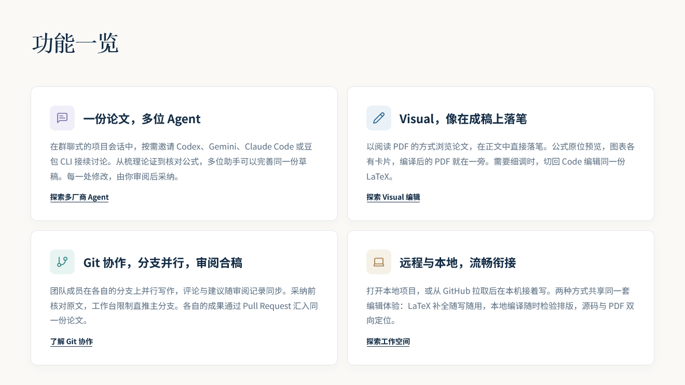
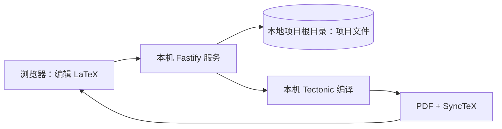
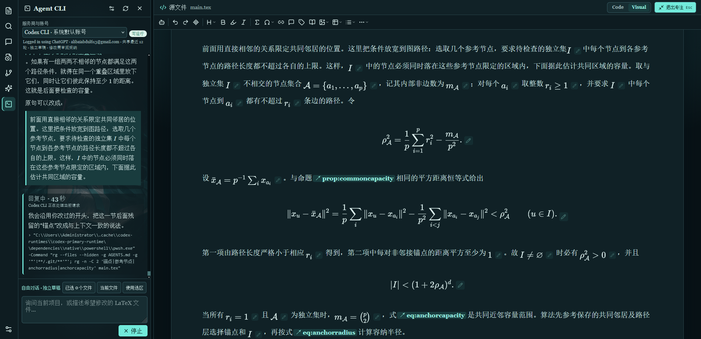
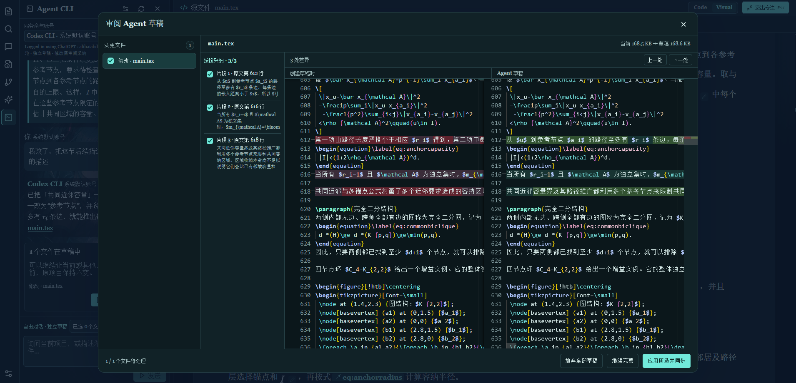
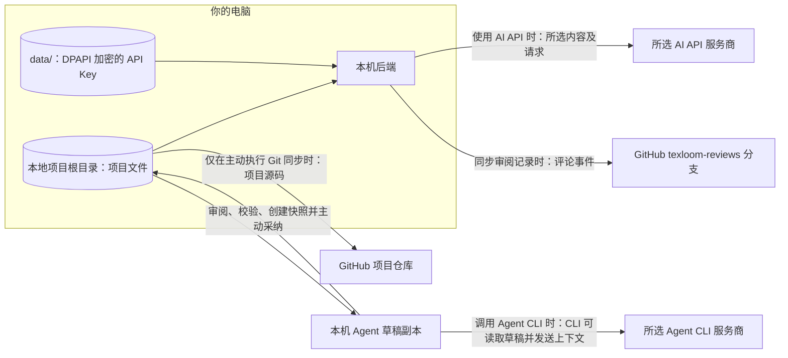

<div align="center">
  
  <h1>TeXloom</h1>
  <p>在 Visual 模式中自然写作，随时切回 LaTeX 源码，并用本地 Tectonic 引擎生成 PDF。</p>
  <p><strong>可视化写作 · 本地编译 · 多服务商智能助手接力</strong></p>
</div>

[在线浏览 TeXloom 产品介绍](https://stuboo3i.github.io/TeXloom/) · [查看 Visual 编辑模式](https://stuboo3i.github.io/TeXloom/#visual) · [了解多服务商 AI](https://stuboo3i.github.io/TeXloom/#ai)


> TeXloom 面向 Windows 单用户桌面环境。项目文件保存在本机；你主动使用 AI 时，所选内容和请求会交给对应服务商，主动使用 Git 同步时项目源码才会推送到远程仓库。

## 功能一览

[](https://stuboo3i.github.io/TeXloom/#features)

- **一份论文，多位 Agent。** 在群聊式的项目会话中，按需让 Codex、Gemini、Claude Code 或豆包 CLI 接续讨论，共同完善一份草稿。审阅每处差异后，再决定采纳哪些修改。
- **Visual，像在成稿上落笔。** 以阅读 PDF 的方式浏览论文，直接编辑正文，原位预览公式。图表各有卡片，编译后的 PDF 在旁边对照，随时可以切回 Code 调整同一份 LaTeX。
- **Git 协作，分支并行，审阅合稿。** 团队成员在各自分支上并行写作，同步评论和建议。采纳前核对原文，工作台限制直推主分支，再通过 Pull Request 审阅合稿。
- **远程与本地，流畅衔接。** 打开本地项目，或从 GitHub 拉取后在本机继续编辑。两种方式都支持 LaTeX 补全、本地编译，以及源码和 PDF 之间的双向定位。

## 一份论文，多位智能助手

TeXloom 把 AI 放进真实的 LaTeX 项目流程。你可以选定项目文件，让 Agent 分析论证、检查引用或提出源码修改；切换服务商或账号后，可将近期项目对话作为下一轮的背景。每个 Agent 仍保留自己的原生会话，便于围绕同一篇文章持续工作。

| 项目级 Agent CLI | 选区级 AI API |
| --- | --- |
| **Codex CLI、Gemini CLI、Claude Code、豆包 CLI**；按项目共享本地对话，可配置账号、模型、超时及支持的智能程度 | **DeepSeek、火山引擎 Ark、阿里云百炼、OpenAI GPT、Claude**；按需调用翻译、润色、报错解释、公式、表格与宏包建议 |
| 选择文件作为上下文；Agent 在工作副本中提出修改，先展示差异，确认后才写回项目 | 选中源码或输入要求，预览结果后再应用；密钥由本机加密保存 |

例如：先用 Codex 检查证明结构，再切换 Gemini 核对叙述，最后用 Claude Code 或豆包 CLI 继续讨论。**这是由你主动切换的协作流程，不会自动调用全部服务商。**跨账号背景共享可以在设置中关闭或调整轮数；普通编辑和本地 PDF 编译无需接入 AI。

## Visual 可视化编辑

在编辑器右上角切换 **Code / Visual**。Visual 把 LaTeX 文档呈现为易读的正文、标题、摘要、命题、证明、列表、公式和图表卡片。你可以直接点击文字修改；点击公式旁的铅笔编辑公式源码。行内与独立公式由本机打包的 KaTeX 预览，最终版式以 Tectonic 编译的 PDF 为准。

### 三步开始写作

1. 在工作台打开一个 `.tex` 项目，点击编辑器右上角的 **Visual**，在接近成稿的阅读视图中浏览文章。
2. 点击正文、标题或公式旁的编辑入口就地修改；用工具栏插入格式、引用和图表。右侧 PDF 可与源码并排查看。
3. 遇到复杂 LaTeX 结构时切回 **Code** 精确调整，保存后点击 **编译 PDF** 检查正式成稿。两种视图始终操作同一份源码。

想先了解界面和工作方式，可打开 [Visual 在线介绍](https://stuboo3i.github.io/TeXloom/#visual)。该页面是静态产品展示；实际编辑、编译与项目管理需要在 Windows 本机运行 TeXloom。

| 在 Visual 中 | 需要精确控制时 |
| --- | --- |
| 就地编辑正文与公式，工具栏按当前可见选区插入格式、引用、图片或表格 | 切回 Code 查看并修改完整 LaTeX 源码 |
| 图表卡片可查看预览、评论、展开源码或单独编译 | 复杂命令与环境可在源码块中编辑；嵌套结构可直接在 Code 中处理 |
| 与右侧 PDF 并排阅读；SyncTeX 可在正文与 PDF 之间定位 | 正式“编译 PDF”始终使用原始项目源码 |

两种模式共用同一份源码、撤销记录、保存和编译流程。**仅切换视图不会重写文件**；Visual 编辑只替换对应的源码片段。`\label` 定位标记在 Visual 中隐藏，但仍保留在源码中。

### 图表卡片与草稿 PDF

- 图片和表格以卡片呈现，图注和表注会按正文、强调与公式渲染。图片预览按需加载；简单表格可直接查看结构预览。
- 点击“编译此卡片”后，卡片会直接显示裁去页面留白的 PDF 排版结果，不再嵌入浏览器 PDF 工具栏；多页结果可在卡片内翻页，也可打开或下载完整 PDF。
- “纳入草稿 PDF”用于控制草稿编译中的图表。未选中的普通 `figure`、`table` 和独立 `\includegraphics` 会在临时副本中变成占位框，便于快速检查文字与结构。
- 草稿结果会单独标记；**正式“编译 PDF”使用完整源码**。`longtable` 及无法安全保留标题或标签的结构始终完整编译，项目源码与正式 PDF 不会被草稿模式覆盖。

页面中的 Visual 示意使用通用示例；实际支持情况可在工作台中用自己的文档查看。

### 产品首页与工作台

| 地址 | 用途 |
| --- | --- |
| [在线产品介绍](https://stuboo3i.github.io/TeXloom/) | GitHub Pages 静态展示页；可浏览 Visual、多人协作、本地管理与多服务商 AI 的介绍 |
| `http://127.0.0.1:3001/` | TeXloom 产品首页，介绍本地编译、双向定位、协作和开源特点 |
| `http://127.0.0.1:3001/?view=workspace` | 实际使用页面：项目分类、导入导出和 LaTeX 编辑器 |

产品首页的“打开工作台”按钮直接进入现有工作台；在项目列表页点击左上角 TeXloom 标识可返回产品首页。在编辑页点击标识会先返回项目列表。产品首页中的编辑器与 PDF 图形是界面示意，实际功能请以工作台为准。

### 从源码到 PDF



## Agent CLI 侧栏

点击侧栏终端图标打开 Agent CLI；侧栏宽度可拖动。每个项目对应一份本地对话记录和一份可复用的 Agent 草稿工作区，消息会标出服务商和账号。回复按 Markdown 展示标题、列表、表格、代码与数学公式，等待模型回复时会显示读秒。Codex 默认直接接收你的问题并自行查看草稿中的项目文件；文件默认不勾选，手动勾选只提供文件路径提示，“使用选区”需主动开启。切换服务商时，设置允许共享的近期对话会作为背景附给新的 Agent。不同服务商和账号各自保留原生线程，项目对话不需要从头重述。

> **Agent 先改草稿，你审阅后再采纳。** TeXloom 将项目复制到本机独立工作区，展示新增、删除及修改的差异；采纳时核对原文件、创建历史快照，遇到冲突则停止写入。调用外部 CLI 前，请确认所选账号和项目内容适合交给该服务商处理。

| CLI | 账号接入 | 模型与智能程度 |
| --- | --- | --- |
| Codex CLI | 系统已登录账号，或新增使用独立 `CODEX_HOME` 的账号 | 可设置模型和推理强度 |
| Gemini CLI | 系统已登录账号，或新增使用独立 `GEMINI_CLI_HOME` 的账号 | 可设置模型；智能程度由 CLI 管理 |
| Claude Code | 每个账号单独填写 Anthropic API Key，并使用独立配置目录 | 可设置模型和受支持的智能程度 |
| 豆包 CLI | 当前使用系统默认登录账号；TeXloom 不自动安装 | 模型与智能程度由豆包 CLI 管理 |



*在同一工作台中与 Agent 讨论论文，同时查看 Visual 正文与公式。*

1. 在“设置 → Agent CLI”选择服务商与账号。Codex、Gemini 和豆包可打开系统终端登录；Claude Code 在此填写 API Key。可为支持的 CLI 设置模型、智能程度、超时和跨账号背景共享轮数。
2. Codex CLI 在 `data/agent-workspaces/` 下的项目草稿目录运行，沿用该账号的原生登录、配置、会话和工具能力。草稿有独立的本地 Git 基线，不继承 TeXloom 或项目仓库的远程地址。它自行决定查看文件、运行命令或修改草稿；CLI 使用工作区写入模式且不逐项审批，采纳前不会通过 TeXloom 写入原项目。
3. 所有 Agent 共用当前项目的草稿，可接着其他 Agent 的未采纳修改继续完善。完成后点击“查看差异并采纳”，可按文件或文本片段选择；新增、删除、图片和其他二进制文件也会列出。采纳时会再次核对原项目文件，冲突时显示原始、当前和草稿版本，不覆盖当前文件。应用成功后刷新 Code／Visual、文件树与引用，并重新编译 PDF。放弃草稿后工作副本会被清理。



*逐项核对 Agent 草稿，只采纳确认过的文件或文本片段。*

CLI 会话与待审阅差异保存在 `data/agent-sessions/`，账号配置保存在 `data/agent-profiles.json`，均不随 Git 项目同步。Claude Code 的 API Key 由 Windows 当前用户的 DPAPI 加密。Agent CLI 与原有 AI API 写作助手相互独立；安装与使用外部 CLI 需遵循各服务商的要求。豆包 CLI 命令参见其[官方文档](https://www.doubao.com/work/docs/zh-cn/doubao-cli)。

在 Windows 启用了系统 HTTPS 代理、但服务进程没有显式代理环境变量时，TeXloom 会把该代理传给 Agent CLI；显式设置的 `HTTPS_PROXY` 或 `ALL_PROXY` 优先。
Agent CLI 默认不限制单轮运行时间，可随时点击“停止”；也可在账号设置中指定运行上限。运行中断时，已写入工作副本的改动仍可审阅或继续完善；界面会把收到的文字标为未完成的回复。工作副本默认每项目一份，闲置且无待采纳修改时自动清理；单个项目副本上限为 1000 个文件或 250 MB。副本包含工作目录、比较基线和本地 Git 对象，占用空间随项目内容与修改量变化。复制和差异比较在本机完成，不消耗 AI token；跨 Agent 交接只附上简短变更清单，Agent 可按需读取详情。

### Agent 草稿的安全流程

| 阶段 | TeXloom 的保护 | 你需要知道的边界 |
| --- | --- | --- |
| 启动 | 在 `data/agent-workspaces/` 建立项目副本与独立的本地 Git 基线，不复制项目仓库的远程地址；Agent 接口检查本机访问来源 | CLI 是以你的系统账号启动的外部程序。工作副本隔离的是 TeXloom 的写回流程，并非 Windows 权限隔离 |
| 提问 | 默认不勾选文件；“使用选区”需主动开启。选区最多 3 万字符；跨账号对话背景可关闭或限制轮数 | Agent 可按自身工具权限读取草稿文件，并可能将问题、读取的内容及共享背景发送给所选服务商。勾选文件或提供选区前先检查敏感内容 |
| 审阅 | 本机比较草稿与基线，显示文本、图片及其他文件的变更；可逐文件或逐段选择采纳 | “分析建议”与“修改文件”是任务意图。不要仅凭模式名称判断外部 CLI 是否写了草稿，以实际差异为准 |
| 采纳 | 先创建项目历史快照，按哈希再次核对基线、草稿和原项目；原项目已变化时报告冲突，不覆盖当前内容 | 正常界面流程中，你点击采纳后 TeXloom 才把所选改动写回原项目。建议仍应检查 LaTeX 内容并重新编译 |

草稿、会话和账号配置位于本机 `data/`，该目录被源码仓库忽略，不会因推送 TeXloom 源码而上传。Codex CLI 在草稿目录使用 `workspace-write` 与免逐项审批模式；这些设置不能阻止同一 Windows 用户权限下的外部程序访问其他可访问位置。请仅使用信任的 CLI、账号和项目；如需更强隔离，应在独立的操作系统账户或虚拟机中运行。

## API Key 管理与多人协作安全

- **项目留在本机。** 项目文件默认放在 `projects/`，也可选择源码仓库之外的自定义根目录；应用不会自动上传项目。默认项目目录及本机设置目录 `data/` 被仓库的 `.gitignore` 排除。只有你主动连接远程仓库并执行 Git 同步时，相应项目源码才会传到该远程仓库。
- **密钥由本机管理。** 可在设置中选择 DeepSeek、火山引擎 Ark、阿里云百炼、OpenAI GPT 或 Claude 原生 API。各服务商的 API Key 分别由 Windows 当前用户的 DPAPI 加密后保存在 `data/ai-settings.json`；切换服务商不会覆盖其他 Key。设置接口只返回是否已配置，不回传明文。调用 AI 时，后端才解密当前服务商的 Key，并将主动提交的提示词、选中文本、上下文或图片发送至该服务商。普通编辑和编译无需 Key。
- **Agent 改动须经采纳。** Agent 在本机项目草稿中运行；TeXloom 先展示差异，再校验文件哈希并创建快照，发生冲突则停止写回。外部 CLI 可读取其账号有权访问的内容并向服务商传输上下文，草稿不是系统级沙箱。详见 [Agent 草稿的安全流程](#agent-草稿的安全流程)。
- **协作使用个人分支。** Git 远程地址只接受不含凭据的 GitHub HTTPS 或 SSH 地址；请使用 Git Credential Manager 或 SSH 登录，不要把令牌放进 URL。应用内拒绝直接推送 `main` / `master`，拉取仅允许快进，并在拉取前检查本地未提交改动。评论与修改建议可同步到独立的 `texloom-reviews` 分支；接受建议前会校验原文。

### 数据何时离开本机



这些限制只约束 TeXloom 内的操作。正式代码审阅和主分支保护请在 GitHub 仓库中配置；不要把仓库访问权限授予不可信人员。

## 部署与启动（Windows 本机）

### 环境要求

- Windows 10/11 和可用的桌面会话；本地文件夹选择功能需要桌面会话。
- Node.js 20.19+ 或 22.12+（推荐 Node.js 24）及 npm；使用克隆命令还需要 Git。
- 仓库中的 `runtime/tectonic.exe`。若该文件缺失，请从 [Tectonic 官方发布页](https://github.com/tectonic-typesetting/tectonic/releases) 下载 Windows 版并放到该路径。
- 使用 Agent CLI 时，按需另行安装对应服务商的命令行工具并完成登录或密钥配置；TeXloom 不自动安装 CLI，基础编辑与本地编译不依赖它。

首次编译时，Tectonic 可能联网下载 LaTeX 支持文件并缓存在本机。服务默认只监听 `127.0.0.1:3001`，供这台电脑上的浏览器访问。

### 首次部署

在 PowerShell 中执行：

```powershell
git clone https://github.com/StuBoo3i/TeXloom.git
cd TeXloom
npm ci --include=dev
npm run build
npm run start
```

构建完成后打开 <http://127.0.0.1:3001/>；点击“打开工作台”进入项目列表，也可直接打开 <http://127.0.0.1:3001/?view=workspace>。保持终端开启，按 `Ctrl+C` 停止服务。

### 日常启动

在 TeXloom 目录双击 `start.cmd`，或在 PowerShell 中执行 `npm run start`。也可以运行 `.\start.ps1`：启动脚本会在缺少 `node_modules/` 时安装依赖、在缺少 `dist/index.html` 时构建网页。PowerShell 若限制运行脚本，使用 `start.cmd` 即可。

### 更新已有部署

先按 `Ctrl+C` 停止服务，再在项目目录执行：

```powershell
git pull --ff-only
npm ci --include=dev
npm run build
npm run start
```

如果通过 ZIP 获取新版本，将新源码放入原目录后执行后面三条 npm 命令。运行时数据位于 `projects/` 和 `data/`，使用自定义根目录的项目仍保留在所选位置；更新源码前请保留这些目录。启动脚本检测到旧的 `dist/index.html` 时不会自动重新构建，因此更新源码后必须执行 `npm run build`。

### 开发模式

```powershell
npm ci --include=dev
npm run dev
```

开发页面位于 <http://127.0.0.1:5173/>，Vite 将 `/api` 请求转发给 <http://127.0.0.1:3001/>；后端修改会由 `tsx watch` 重启。正式使用页面由 `npm run build` 生成并通过 `npm run start` 提供。

## 使用

1. **进入工作台。** 从产品首页点击“打开工作台”，进入项目分类与列表页面。
2. **创建或导入。** 新建项目、导入含 `.tex` 文件的 ZIP，或从本地文件夹批量导入。
3. **编辑。** 在左侧选择文件，在中间编辑源码。修改会自动保存，也可点击“保存”。
4. **编译与预览。** 点击“编译 PDF”，在右侧查看最新的成功结果；底部可展开编译日志。
5. **整理与导出。** 上传资源、设置主 `.tex` 文件，下载 PDF，或导出项目 ZIP；工作台项目页还可批量导出项目文件夹。

**自动编译：** 小项目默认开启；主文件达到 100 KB 时默认关闭。可用顶部循环箭头按钮手动切换。

**页面布局：** 顶部“布局”菜单提供拆分视图、仅编辑器、仅 PDF，以及在新标签页打开 PDF。拆分视图可拖动中间分隔条；双击恢复各占一半。布局和宽度按项目保存。

**项目根目录：** 首次在工作台项目页点击“新建项目”时会先出现根目录选择窗口。部署后默认创建 `projects/`；可直接使用它，也可通过 Windows 文件夹选择器指定其他目录。此设置保存在本机 `data/workspace.json`。更换根目录后，新建、导入和 GitHub 克隆的项目写入新位置；已有项目保留在原位置且仍可打开。点击右上角“本地工作空间”，可查看当前项目文件夹、所属根目录及新项目根目录，并随时修改新项目根目录。自定义根目录须位于 TeXloom 源码目录之外，且不能与其他已登记根目录嵌套。

### 首页分类与批量文件夹操作

**筛选与归档**

- 按所有、个人、共享、归档或自定义标签筛选项目，也可搜索项目。
- 在项目卡片上调整分类、标签，或归档与恢复。归档不会删除文件。
- GitHub 导入的项目默认归为共享。已有 GitHub 项目若未设置分类，会参考本地提交作者数量推断；分类也可手动调整。**“共享”只是本地分类，不代表 GitHub 权限。**

**批量导入**

1. 点击“从本地文件夹批量导入”。选择含 `.tex` 文件的项目目录，或包含多个项目子目录的父目录。
2. 预览候选项目，确认后复制到 TeXloom。

每次最多导入 30 个项目。单个项目上限为 1000 个文件、100 MB；单文件上限为 20 MB。导入时跳过 Git 历史、内部缓存、`.env` 和常见私钥文件。

**批量导出**

勾选项目并点击“导出到本地文件夹”。每个项目写入独立目录；同名目录会自动编号，不覆盖现有内容。导出的 `.texloom-project.json` 保存项目名称、主文件、分类与标签，重新导入时可恢复这些设置。

文件夹选择器需要 Windows 桌面会话。

## 编辑与项目工具

### 写作与定位

- 顶部菜单集中管理文件、编辑、视图和项目操作。编辑器工具栏提供撤销、重做、标题、格式、公式、符号、链接、列表、引用、图片和表格等常用操作；操作作用于 Monaco 当前光标或选区，并可撤销。
- 源码编辑器按光标位置补全常用 LaTeX 命令、数学符号、环境、宏包、项目标签、文献键、项目文件路径，以及当前文件定义的命令。标题、分式、图片等补全项提供可跳转的参数模板；注释和逐字环境内不会弹出 LaTeX 补全。项目标签和文献键会从当前项目的 `.tex`、`.bib` 文件读取。
- LaTeX 命令、环境、标题、引用、公式、数字和注释会随网页颜色风格着色。
- Visual 模式的正文、公式和图表编辑方式，以及草稿 PDF 与正式 PDF 的区别，见上面的 [Visual 可视化编辑](#visual-可视化编辑)。切换模式会保留阅读位置；工具栏还支持按设置中的颜色插入 LaTeX 高亮。
- 编译后点击定位按钮，或按 `Ctrl+Alt+J`，可从源码跳转到 PDF；双击 PDF 页面可返回源码行。此功能依赖 SyncTeX 数据，已有的旧 PDF 需要重新编译。

### 引用、资源与检索

- 引用面板实时整理当前源码中的标签，并读取项目其他 `.tex`、`.bib` 文件；支持搜索、按图/表/公式/章节/文献分类和手动输入键。文献键同时来自 `thebibliography` 的 `\bibitem` 与 `.bib` 条目，列表展示标题、作者及来源。选择公式插入 `\eqref`（必要时补充 `amsmath`），选择文献插入 `\cite`，其他标签插入 `\ref`；可点击“更新列表”重新读取项目文件。
- 图片可从本机上传、从当前或其他项目复制，也可从公开 HTTPS URL 导入 PNG、JPEG 或 PDF。插入链接和图片时，若主文件缺少 `hyperref` 或 `graphicx`，应用会补充宏包声明。
- 文件树支持折叠目录；文档大纲按主文件的 `\input` / `\include` 顺序展示标题。
- 全项目搜索支持大小写、全词和正则表达式，可定位或批量替换。搜索最多读取前 200 个文本文件（每个不超过 2 MB），最多显示 500 处结果。

### 审阅、历史与 Git

- 审阅面板保存评论、回复和修改建议。接受建议前会核对原文；来自其他分支的评论会标出来源，源码变化时提示重新检查位置。
- 历史面板可创建和恢复 ZIP 快照；恢复前会自动备份。
- Git 面板支持初始化仓库、提交和查看记录，配置 GitHub HTTPS 或 SSH 远程地址，拉取、推送、管理分支，以及只读查看源码和差异。面板会显示同步状态，并提供审阅同步和 Pull Request 入口。首次成功提交后，提交者姓名和邮箱会记为本机默认值。

### 外观

设置面板可调整网页字体、字号及六种颜色风格，包括夜间与护眼模式。外观设置保存在本机浏览器；编辑器字号可单独调整，PDF 排版不受网页外观影响。

## GitHub 私有仓库协作

### 连接仓库

1. 仓库所有者在 GitHub 邀请协作者，协作者接受邀请。每人使用自己的 GitHub 账号。
2. 在首页选择“导入 GitHub 私有仓库”，输入以下任一格式的仓库地址：

   ```text
   https://github.com/owner/repo.git
   git@github.com:owner/repo.git
   ```

3. HTTPS 首次连接通过本机 Git Credential Manager 登录；也可预先配置 SSH。**不要把访问令牌写进仓库 URL。**

### 分支工作流

1. 在 Git 面板点击“获取分支”，选择远程分支，只读查看源码及与当前分支的差异。
2. 创建 `feature/姓名/主题` 等个人分支，编辑、提交并推送。
3. 使用面板提供的链接，在 GitHub 发起 Pull Request 并完成正式审阅。

应用内不允许直接推送 `main` 或 `master`。拉取仅允许快进，不自动覆盖分叉历史。切换分支或拉取源码后，旧 PDF 预览会清除，需要重新编译。

### 审阅记录

在 Git 面板填写“本机审阅署名”，即可添加评论、回复和修改建议。点击“同步审阅记录”可单独同步；普通推送和拉取也会尝试同步。

- 审阅事件以独立 JSON 文件存放在远程 `texloom-reviews` 分支。本机服务端在拉取后校验、去重并重建审阅面板。
- 断网时，本地事件保留在 `.openleaf/review-outbox/` 等待重试。旧 `.openleaf/review.json` 会迁移为事件文件。
- 本机填写的审阅署名只是显示名，不代表经过 GitHub 身份验证；正式批准请使用 GitHub Pull Request 审阅。

### 协作边界

- 本地 `project.json`、编译结果、快照和凭据不应进入远程源码仓库。旧版项目若已跟踪 `project.json`，下次 Git 初始化或提交会将其从索引移除，但保留本地文件；远程删除仍需通过后续提交和 Pull Request 合并。
- GitHub Free 私有仓库的协作者拥有写权限，不能依赖免费的私有分支保护强制批准合并。TeXloom 的主分支限制只约束应用内操作。

## AI 助手

1. 在左侧“设置 → AI API”选择 DeepSeek、火山引擎 Ark、阿里云百炼、OpenAI GPT 或 Claude，填写对应 API Key 和模型 ID，并设置输出上限和超时。可分别保存多家服务商的配置。
2. 在 AI 面板选择问答、翻译、润色、报错解释、源码改写、公式或表格生成，也可输入自定义指令。
3. 先预览原文与生成结果，再决定是否应用到编辑器。表格插入面板还可用支持视觉输入的模型识别 PNG/JPEG 表格图片。

**宏包建议：** AI 面板的“宏包建议”页可先用本地规则分析主文件、需求和最近编译日志，无需 API Key。配置 Key 后，可主动点击“AI 分析”，让所选服务商结合需求、当前选中的源码、主文件导言区及可选日志推荐宏包。后端只接受内置目录中的宏包名称，标出已经加载的宏包，并提供 CTAN 资料。点击“预览并添加”查看要插入的 `\usepackage` 声明；确认时会核对主文件是否变化，防止覆盖新编辑。添加后请实际编译确认兼容性；建议不会自动下载或安装宏包。

**项目级 Agent：** 侧栏 Agent CLI 可在 Codex、Gemini、Claude Code 与豆包之间切换，携带所选文件和允许共享的项目对话继续讨论；账号、模型及共享轮数见 [Agent CLI 侧栏](#agent-cli-侧栏)。AI API 快捷工具与 Agent CLI 可分别配置，按写作任务选用。

**密钥与数据：** Key 由本机后端使用 Windows 当前用户的 DPAPI 加密保存，不写入浏览器存储、项目文件或导出的 ZIP。AI 写作请求会把你选择的文本、输入的要求，以及明确使用的编译日志发送到当前所选服务商。宏包分析仅在点击“AI 分析”时发送需求、选中的源码（最多 3000 字符）、导言区（最多 12000 字符）及勾选的日志（最多 4000 字符）。

**费用：** 普通编辑、编译和项目管理无需 API Key。TeXloom 本身不设付费功能；各 AI API 与 Agent CLI 依照你所使用的账户和服务规则计费。

**本地数据：** 项目默认存储在 `projects/`，自定义根目录记录在 `data/workspace.json`；删除项目会删除其实际所在目录中的相应文件。默认的 `projects/`、`data/`、`dist/` 和 `node_modules/` 不纳入版本控制。

## 目录结构

| 路径 | 内容 |
| --- | --- |
| `client/` | React 前端、编辑器及 PDF 预览 |
| `server/` | Fastify API、编译、Git 协作及本地设置 |
| `runtime/tectonic.exe` | Windows LaTeX 编译引擎 |
| `tests/` | 功能测试和端到端冒烟测试 |
| `projects/`、`data/` | 运行时生成的本地数据，不提交到 Git |

## 实现说明

| 部分 | 实现 |
| --- | --- |
| 网页界面 | React、Vite、Monaco Editor、PDF.js |
| 本地服务 | Fastify 提供项目、文件与编译 API，默认只监听 `127.0.0.1` |
| PDF 编译 | 后端通过 Node.js `spawn` 调用 `runtime/tectonic.exe`，执行 `tectonic -X compile --untrusted --synctex`，并限制并发与编译时长 |

服务适合单用户本机使用。`--untrusted` 会关闭 Tectonic 已知的不安全功能，但不等同于操作系统级隔离；请勿导入来源不可信的项目。

TeXloom 源码采用 MIT 许可证，见 `LICENSE`。第三方许可证与来源见 `THIRD_PARTY_NOTICES.md` 和 `licenses/`。

## 验证

```powershell
npm run build
npx tsx --test tests/editor-features.test.ts tests/synctex.test.ts tests/git-collab.test.ts tests/review-events.test.ts tests/latex-completion.test.ts tests/package-advice.test.ts tests/visual-latex.test.ts
```

其他验证方式及其运行条件：

| 测试 | 验证内容与条件 |
| --- | --- |
| `tests/api-smoke.mjs`、`tests/ai-settings-smoke.mjs` | 设置 `TEXLOOM_URL`；使用临时测试项目或测试密钥 |
| `tests/ai-stream-smoke.ts` | 用本地模拟响应验证流式链路，不访问外部 AI 服务 |
| `tests/agent-provider.test.ts`、`tests/agent-session.test.ts` | 验证 API 服务商、Agent CLI 会话迁移、跨账号背景共享、密钥隔离及豆包 Windows 命令适配 |
| `tests/collaboration-smoke.mjs` | 用两个临时项目和本地临时裸仓库验证分支与审阅同步；测试服务需设置 `TEXLOOM_TEST_LOCAL_GIT=1` |
| `tests/folder-projects-smoke.mjs` | 验证批量导入导出、分类元数据、防覆盖和敏感文件跳过；测试服务需设置 `TEXLOOM_TEST_FOLDER_PICKER=1` |
| `tests/package-advice-smoke.mjs` | 在运行中的本地服务创建并删除临时项目，检查宏包建议、预览防覆盖和 Tectonic 实际编译；默认访问 `3002`，也可设置 `TEXLOOM_URL` |

普通服务只接受 GitHub 远程仓库；正式服务不接受客户端传入的文件夹路径。

## 常见问题

| 情况 | 建议 |
| --- | --- |
| 提示“未找到 Tectonic 引擎” | 确认 `runtime/tectonic.exe` 存在。 |
| 首次编译较慢 | Tectonic 可能正在下载并建立缓存。 |
| 大型文档编译较慢 | 目录、交叉引用可能触发多轮排版，TikZ 也会增加耗时。可关闭自动编译，完成一段后再手动编译。 |
| 中文显示异常 | 检查系统中文字体，并在 LaTeX 源文件中指定可用字体。 |
