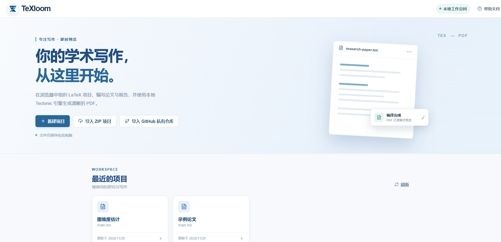
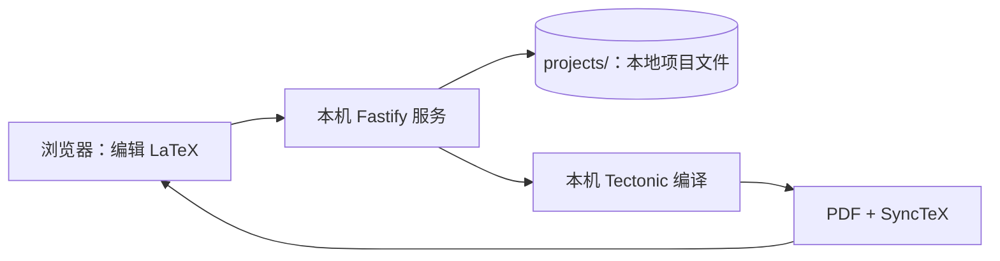
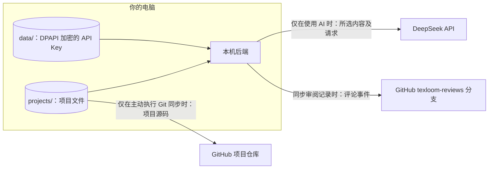

<div align="center">
  
  <h1>TeXloom</h1>
  <p>在浏览器中组织 LaTeX 项目、专注写作，并用本地 Tectonic 引擎生成 PDF。</p>
  <p><strong>本地工作空间 · 即时预览 · GitHub 私有仓库协作</strong></p>
</div>



> TeXloom 面向 Windows 单用户桌面环境。项目文件保存在本机；只有你主动使用 Git 协作时，所选项目的源码才会同步到对应远程仓库。

## 功能一览

| 写作与预览 | 项目管理 | 协作与扩展 |
| --- | --- | --- |
| Monaco 编辑器、LaTeX 工具栏、PDF 预览与 SyncTeX 双向定位 | 项目分类与标签、批量导入导出、文件树、全文搜索、历史快照 | GitHub 私有仓库分支协作、评论与修改建议、可选 DeepSeek 助手 |

### 从源码到 PDF



## API Key 管理与多人协作安全

- **项目留在本机。** 项目文件放在 `projects/`，应用不会自动上传项目；该目录及本机设置目录 `data/` 均被仓库的 `.gitignore` 排除。只有你主动连接远程仓库并执行 Git 同步时，相应项目源码才会传到该远程仓库。
- **密钥由本机管理。** DeepSeek API Key 由 Windows 当前用户的 DPAPI 加密后保存在 `data/ai-settings.json`。设置接口只返回是否已配置，不回传明文；可在设置中清除 Key、调整模型、输出上限和超时。调用 AI 时，后端才解密 Key，并将你提交的提示词、选中文本、额外上下文或图片发送至 DeepSeek。普通编辑和编译无需 Key。
- **协作使用个人分支。** Git 远程地址只接受不含凭据的 GitHub HTTPS 或 SSH 地址；请使用 Git Credential Manager 或 SSH 登录，不要把令牌放进 URL。应用内拒绝直接推送 `main` / `master`，拉取仅允许快进，并在拉取前检查本地未提交改动。评论与修改建议可同步到独立的 `texloom-reviews` 分支；接受建议前会校验原文。

### 数据何时离开本机



这些限制只约束 TeXloom 内的操作。正式代码审阅和主分支保护请在 GitHub 仓库中配置；不要把仓库访问权限授予不可信人员。

## 快速开始

```powershell
git clone https://github.com/StuBoo3i/TeXloom.git
cd TeXloom
.\start.ps1
```

也可以在资源管理器中双击 `start.cmd`。首次启动会自动安装 npm 依赖并构建网页，完成后访问 **<http://127.0.0.1:3001>**。终端需要保持开启；按 `Ctrl+C` 停止服务。

## 环境

- Windows 10/11
- Node.js 20.19+ 或 22.12+；推荐 Node.js 24
- `runtime/tectonic.exe`（仓库附带 [Tectonic 官方 Windows 版](https://github.com/tectonic-typesetting/tectonic/releases)；如文件缺失，请从官方发布页下载并放到该路径）

首次编译时，Tectonic 可能联网下载 LaTeX 支持文件并缓存在本机。此后常用文件可复用缓存。

## 启动

双击 `start.cmd`，或在源码目录打开 PowerShell 后运行：

```powershell
.\start.ps1
```

浏览器打开 <http://127.0.0.1:3001>。修改前端源码后运行 `npm run build`，再重启服务；启动脚本只在缺少构建文件时自动构建。

开发模式：

```powershell
npm install
npm run dev
```

开发页面位于 <http://127.0.0.1:5173>，API 位于 `127.0.0.1:3001`。

## 使用

1. 新建项目，导入包含 `.tex` 文件的 ZIP，或从本地文件夹批量导入；项目首页支持分类、标签和搜索。
2. 在左侧选文件，中间编辑源码。修改后自动保存，也可以点击“保存”。
3. 点击“编译 PDF”。右侧显示最新的成功结果；底部可查看编译日志。小项目默认自动编译；主文件达到 100 KB 时默认关闭自动编译，可用顶部循环箭头按钮切换。
4. 可以上传资源、设置主 `.tex` 文件、导出项目 ZIP 或下载 PDF；也可以选择多个项目批量导出到本地文件夹。

编辑页顶部的“布局”菜单可以切换拆分视图、仅编辑器和仅 PDF，也可以在新标签页打开 PDF。拆分视图的中间分隔条可拖动，双击可恢复各占一半；每个项目会记住自己的布局和宽度。

### 首页分类与批量文件夹操作

- 首页按所有、个人、共享、归档及自定义标签筛选项目；项目卡片可切换分类、归档或恢复、设置标签。归档不删除文件。GitHub 导入的项目默认归为共享；已有 GitHub 项目若未设置分类，会根据本地提交作者数量推断，也可手动调整。共享分类只用于本地整理，不授予或验证 GitHub 权限。
- 点击“从本地文件夹批量导入”后，选择一个含 `.tex` 文件的项目目录，或包含多个项目子目录的父目录。先预览候选项目，再确认复制到 TeXloom。一次最多 30 个项目；每个项目最多 1000 个文件、100 MB，单文件最多 20 MB。导入跳过 Git 历史、内部缓存、`.env` 和常见私钥文件。
- 勾选项目并点击“导出到本地文件夹”，每个项目写入独立目录。同名目录会自动编号，不覆盖原有内容。导出的 `.texloom-project.json` 保存项目名称、主文件、分类与标签，重新导入时恢复这些设置。系统文件夹选择器要求 Windows 桌面会话。

## 编辑与项目工具

- 顶部菜单统一管理文件、编辑、视图和项目操作。编辑器容器内的工具栏支持撤销、重做、正文与各级标题、粗体、斜体、公式、符号、链接、列表、交叉引用、文献引用、图片和表格。按钮作用于 Monaco 当前光标或选区，编辑可撤销。
- LaTeX 命令、环境、标题、引用、公式、数字和注释按当前网页颜色风格着色。编译后，点击编辑器工具栏的定位按钮或按 `Ctrl+Alt+J` 可跳到 PDF 对应位置；双击 PDF 页面可返回源码行。此功能依赖编译生成的 SyncTeX 数据，升级前已有的 PDF 需要重新编译一次。
- 引用面板读取项目中的 `\label{...}` 和 `.bib` 文献键。图片可从本机上传、当前项目、其他项目复制，或从公开 HTTPS URL 导入 PNG、JPEG、PDF。插入链接和图片时，主文件缺少 `hyperref` 或 `graphicx` 会自动补充宏包声明。
- 左侧文件树可折叠目录；文档大纲按主文件的 `\input` / `\include` 顺序展示标题。全项目搜索支持大小写、全词和正则表达式，可定位和批量替换。搜索至多读取前 200 个文本文件，每个文件不超过 2 MB；结果最多显示 500 处。
- 审阅面板保存评论、回复和修改建议。接受建议前会检查原文是否仍与创建建议时一致；从其他分支收到的评论会标出来源，源码已变化时提示重新核对位置。历史面板可以创建 ZIP 快照并恢复，恢复前自动创建备份。
- Git 面板可在项目内初始化仓库、提交、查看提交记录，配置 GitHub HTTPS 或 SSH 远程地址并拉取、推送。提交者姓名和邮箱首次成功提交后记为本机默认值。面板显示推送或拉取状态，并提供分支选择、创建、只读查看源码及差异、审阅同步和 Pull Request 入口。
- 设置面板可调整整个网页界面的字体、字号与六种颜色风格，包括夜间和护眼模式。设置保存在本机浏览器；编辑器字号仍可单独设置，PDF 的排版不受网页外观影响。

## GitHub 私有仓库协作

1. 仓库所有者在 GitHub 邀请协作者，协作者接受邀请。每人使用自己的 GitHub 账号；在首页选择“导入 GitHub 私有仓库”，填写 `https://github.com/owner/repo.git` 或 `git@github.com:owner/repo.git`。HTTPS 首次连接通过本机 Git Credential Manager 登录；也可预先配置 SSH。不要把访问令牌写进仓库 URL。
2. 在 Git 面板点击“获取分支”，选择远程分支只读查看源码和与当前分支的差异。创建 `feature/姓名/主题` 等个人分支后编辑、提交并推送；面板提供 GitHub Pull Request 链接。应用内不允许直接推送 `main` 或 `master`，拉取使用快进模式，不自动覆盖分叉的历史。切换或拉取源码后，旧 PDF 预览会清除，需重新编译。
3. 在 Git 面板填写“本机审阅署名”。添加评论、回复和修改建议后，点击“同步审阅记录”；普通推送和拉取也会尝试同步。审阅事件以独立 JSON 文件保存在远程 `texloom-reviews` 分支，拉取后由本机服务端校验、去重并重建审阅面板。断网时本地事件留在 `.openleaf/review-outbox/` 等待重试；旧 `.openleaf/review.json` 会迁移为事件文件。

本地 `project.json`、编译结果、快照和凭据不应进入远程源码仓库。旧版项目若已跟踪 `project.json`，下次 Git 初始化或提交会将其从 Git 索引移除，保留本地文件；远程对应删除需通过后续提交和 Pull Request 合并。仓库内的审阅署名是本地填写的显示名，不是 GitHub 验证身份；正式批准使用 GitHub Pull Request 审阅。GitHub Free 私有仓库的协作者拥有写权限，且不能依赖免费的私有分支保护强制批准合并。TeXloom 的主分支限制只约束本应用内的操作。

## AI 助手

在左侧“设置”填写自己的 DeepSeek API Key，选择模型并设置输出上限和超时。Key 由本机后端使用 Windows 当前用户的 DPAPI 加密保存，不写入浏览器存储、项目文件或导出的 ZIP。AI 面板支持问答、翻译、润色、报错解释、源码改写、公式与表格生成、自定义指令；表格插入面板还能使用支持视觉输入的模型从 PNG/JPEG 图片识别表格。生成的源码先预览原文和结果，再由用户应用到编辑器。

普通编辑、编译和项目管理无需 API Key。TeXloom 本身不设付费功能；DeepSeek API 由用户自己的账户按其服务规则计费。AI 请求会把用户选择的文本、输入的要求和明确使用的编译日志发送到 DeepSeek。

项目数据存储在 `projects/`。删除项目会删除相应的本地文件。`projects/`、`data/`、`dist/` 和 `node_modules/` 不纳入版本控制。

## 目录结构

| 路径 | 内容 |
| --- | --- |
| `client/` | React 前端、编辑器及 PDF 预览 |
| `server/` | Fastify API、编译、Git 协作及本地设置 |
| `runtime/tectonic.exe` | Windows LaTeX 编译引擎 |
| `tests/` | 功能测试和端到端冒烟测试 |
| `projects/`、`data/` | 运行时生成的本地数据，不提交到 Git |

## 实现说明

- React、Vite、Monaco Editor、PDF.js 构成网页界面。
- Fastify 提供项目、文件与编译 API。
- 后端通过 Node.js `spawn` 调用 `runtime/tectonic.exe`，使用 `tectonic -X compile --untrusted --synctex`，限制并发和编译时长。
- 服务默认只监听 `127.0.0.1`，适合单用户本机使用。`--untrusted` 会关闭 Tectonic 已知的不安全功能，但不等同于操作系统级隔离；不要导入来源不可信的项目。
- TeXloom 源码使用 MIT 许可证，见 `LICENSE`。第三方许可证与来源见 `THIRD_PARTY_NOTICES.md` 和 `licenses/`。

## 验证

```powershell
npm run build
npx tsx --test tests/editor-features.test.ts tests/synctex.test.ts tests/git-collab.test.ts tests/review-events.test.ts
```

`tests/api-smoke.mjs` 和 `tests/ai-settings-smoke.mjs` 需要另起服务并设置 `TEXLOOM_URL`；它们使用临时测试项目或测试密钥。`tests/ai-stream-smoke.ts` 使用本地模拟响应检查流式链路，不访问 DeepSeek。

`tests/collaboration-smoke.mjs` 使用两个临时项目和一个本地临时裸仓库验证分支与审阅同步。仅在测试服务器设置 `TEXLOOM_TEST_LOCAL_GIT=1` 时运行；普通服务只接受 GitHub 远程仓库。

`tests/folder-projects-smoke.mjs` 验证批量导入导出、分类元数据、防覆盖和敏感文件跳过。仅在单独测试服务器设置 `TEXLOOM_TEST_FOLDER_PICKER=1` 时运行；正式服务不接受客户端传入的文件夹路径。

## 常见问题

- “未找到 Tectonic 引擎”：确认 `runtime/tectonic.exe` 存在。
- 首次编译较慢：通常正在下载和建立 Tectonic 缓存。
- 大型文档编译较慢：目录、交叉引用会触发多轮 TeX 排版，TikZ 图形也会增加耗时。可关闭自动编译，写完一段后手动编译。
- 中文显示异常：检查系统是否安装中文字体，并在 LaTeX 源文件中指定可用字体。
